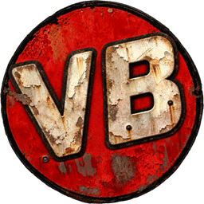
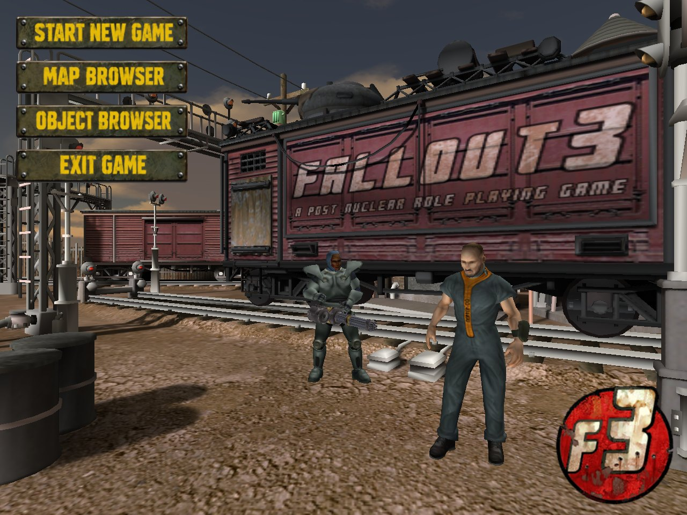
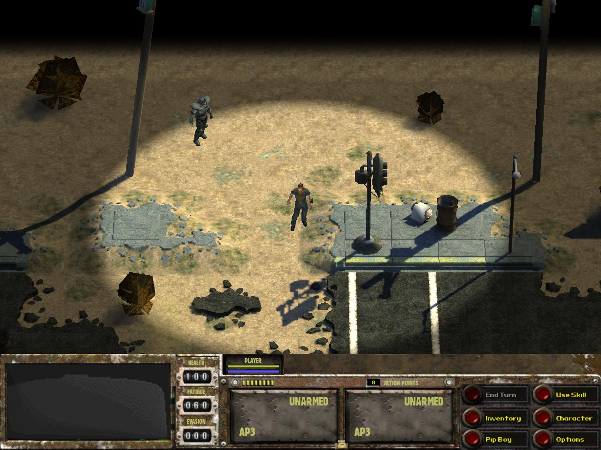
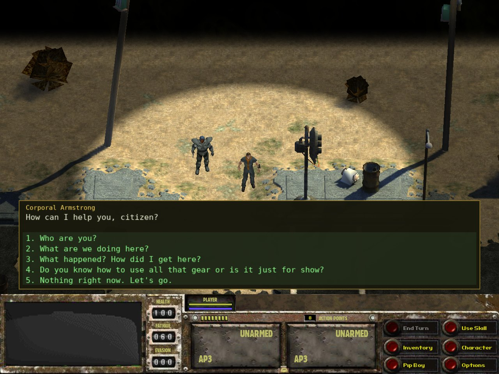
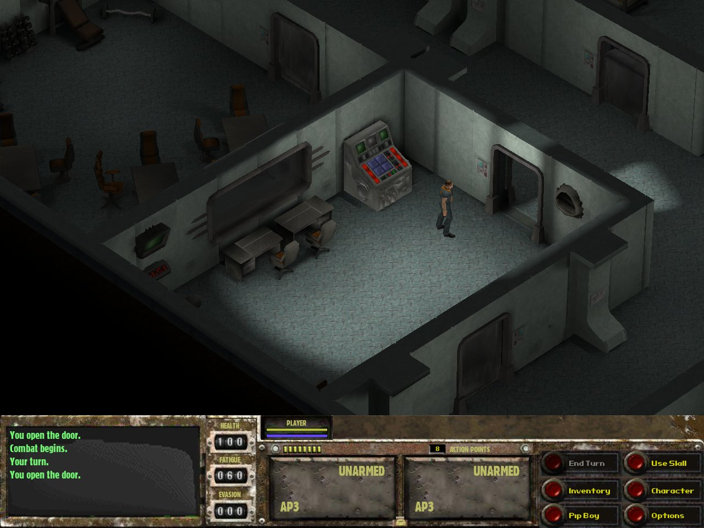
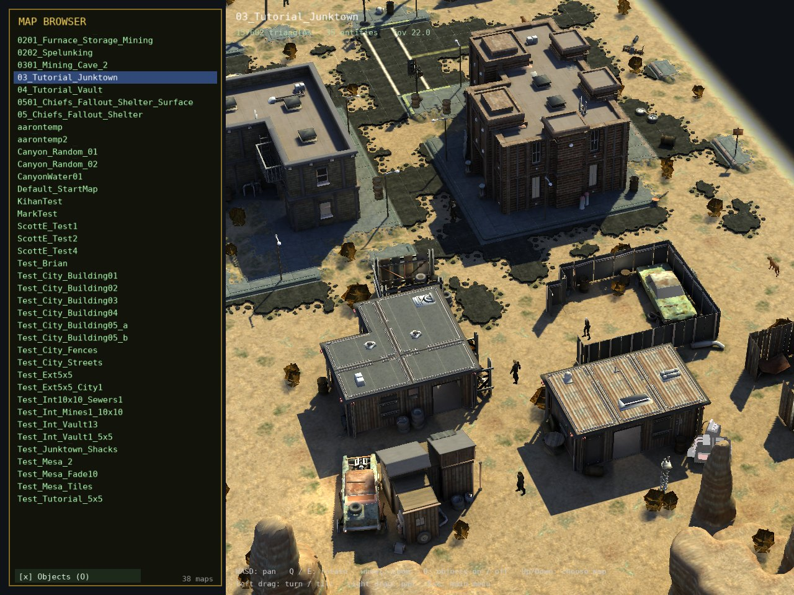
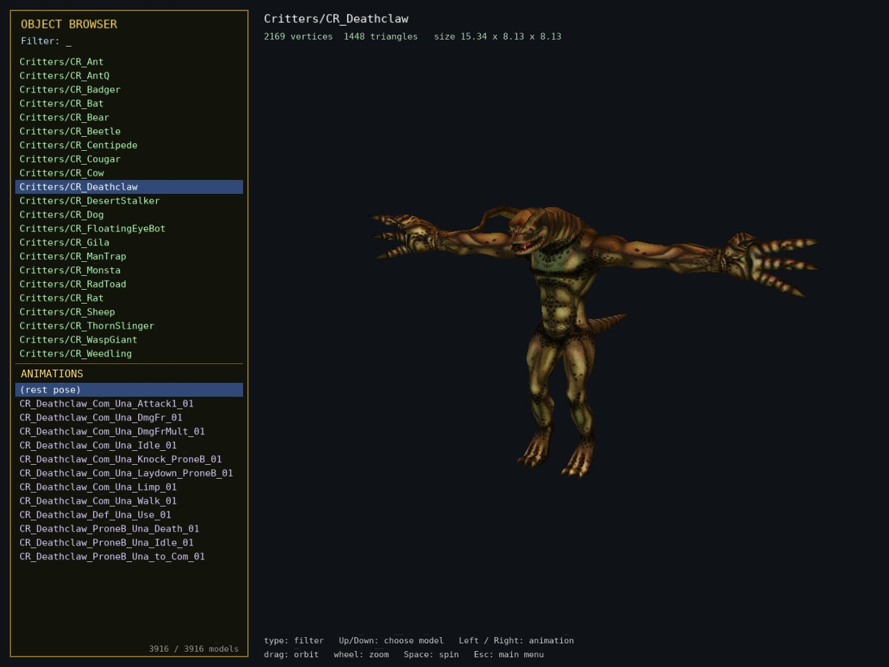

<p align="center"></p>

# Open Van Buren

A native Linux engine for the **Fallout 3 "Van Buren" tech demo** (the cancelled Black Isle game), written from scratch in C++17.
It reads the demo's own packaged data files and runs its own scripts, so it can replace `F3.exe` on Linux without Wine.

> **You need your own copy of the tech demo.** This repository contains no game assets, only code and notes.
> The tech demo (`F3_Demo.rar`) can be found at <https://archive.org/download/f3demo>; extract the archive (7-Zip or `unrar`) and point Open Van Buren at the resulting folder (see [Run](#run)).
> Not affiliated with or endorsed by Bethesda Softworks, Interplay or Black Isle Studios; *Fallout* is a trademark of Bethesda Softworks.

<table>
  <tr>
    <td></td>
    <td></td>
  </tr>
  <tr>
    <td></td>
    <td></td>
  </tr>
  <tr>
    <td></td>
    <td></td>
  </tr>
</table>

*Main menu, Junktown, a conversation, the Vault, and the Map and Object Browsers. The screenshots show the tech demo's own art and content, which belongs to its owners.*

## About this project

* **Built with Claude.** The reverse engineering (the file formats, the scripting bytecode, parts of the engine's behaviour from `F3.exe`) and all of the coding were done
  with [Claude](https://www.anthropic.com/claude), Anthropic's AI model, working through Claude Code. The direction, the testing and the design decisions are the maintainer's.
* **True to the demo, with some polish.** The aim is to match the original tech demo, and wherever its data defines something (the camera, the start map, the scripts, the
  strings, the sounds) the engine follows that data. A few of the demo's rougher edges have been smoothed, and where its behaviour could not be worked out from its files
  the engine makes a reasoned guess; those are listed in [docs/PLAN.md](docs/PLAN.md) and the other notes in [docs/](docs/).
* **Added:** the **Map Browser** and the **Object Browser** on the main menu (see below).
* **Removed:** a few non-functional parts of the demo, such as the character-creation screen. Start New Game goes straight into the game.

## Status

A playable first-pass of the tech demo's content:

* **Main menu**: the 3D scene with the rolling-in train; Start New Game, Map Browser, Object Browser, Exit Game.
* **World**: all 38 maps load (the Junktown and Vault tutorial maps are the playable ones). Lighting and the tech demo's fog of war, building roofs fading out, animated
  characters (Granny2 skeletons and animations, including the Oodle0 decompressor) and effects (`.vfx`: fire, smoke, lightning, particles).
* **Game logic**: the original entity and dialogue scripts (Pawn/"Small" bytecode) run in a VM with 109 natives implemented: dialogue, journal, doors, containers,
  skills, the generator repair and life-support chain, the eye bot, and so on.
* **Play**: click to walk (A* pathfinding), talk, use, loot; inventory and equipment; turn-based combat with action points; death.
* **Audio** (OpenAL Soft): positional effects, ambient emitters, interface sounds and the streamed music.
* **Browsers**: the Map Browser shows any map with the game's camera (objects can be hidden); the Object Browser shows any of the 3,916 models with its animations.

Known gaps are listed in [docs/PLAN.md](docs/PLAN.md). Several audio details (the music volume, the sound sequencing) are educated guesses.

## Download

Prebuilt x86_64 Linux builds are attached to each [release](../../releases). Neither contains any game data.

* **`vanburen-<version>-x86_64.AppImage`**: one file with SDL2, GLEW, OpenAL and their dependencies bundled (FreeType, the graphics driver and libc come from your system). `chmod +x` it and put it **next to the tech demo's `F3.exe`** (or start it with `-game /path/to/the/demo`).
  AppImages need FUSE 2 (`sudo apt install libfuse2` on recent Ubuntu / Mint); without it run `./vanburen-*.AppImage --appimage-extract-and-run`.
* **`vanburen-<version>-linux-x86_64.tar.gz`**: just the binary, linked against your system's SDL2, GLEW, FreeType and OpenAL.

To build it yourself instead, read on.

## Requirements

* Linux, a GPU with OpenGL 3.3+, CMake 3.16+, a C++17 compiler
* SDL2, GLEW, FreeType, OpenAL Soft (development packages), e.g. on Debian / Ubuntu:
  `sudo apt install build-essential cmake libsdl2-dev libglew-dev libfreetype-dev libopenal-dev`

## Build

```bash
cmake -S . -B build -DCMAKE_BUILD_TYPE=Release
cmake --build build -j"$(nproc)" --target vanburen
```

## Run

Put the `vanburen` binary (or the AppImage) next to the tech demo's `F3.exe` (the folder that holds `resource.rht` and `data/`) and start it. Anywhere else, point it at the folder:

```bash
build/vanburen -game /path/to/the/tech/demo        # or: VB_GAME_DIR=/path/to/the/tech/demo build/vanburen
build/vanburen -game /path/to/the/tech/demo 03_Tutorial_Junktown   # straight into a map
```

The files are read directly from the demo's `.grp` archives (memory-mapped; nothing is extracted), and loose files in the demo's `Override/` folder take precedence.
Start New Game starts the map named by the demo's `Engine/sys.ini` (`Start map`), so the Vault demo variant starts in the Vault.

### Controls

| Key / mouse | Action |
|---|---|
| `W A S D` | pan the camera (Shift: faster) |
| `Q` / `E` | rotate the camera |
| mouse wheel | zoom |
| left click | walk there; click a person, door, container or item to use it |
| `I` `K` `J` | inventory, character, journal |
| `Enter` | end your turn in combat |
| `1`-`9` or click | answer in a dialogue |
| `Esc` | close a window, or open the options menu (resume, quit to the main menu, quit) |
| `F1` | the full list, including the debug keys |

In the **Map Browser**: `W A S D` pan, `Q` / `E` rotate, wheel zoom, left-drag turns and tilts, right-drag pans, `O` shows / hides the map's objects.
In the **Object Browser**: type to filter the list, click a model, drag to orbit, wheel to zoom, pick an animation from the list below.

## Other tools

All of them find the demo folder the same way as `vanburen` (`-game DIR`, `VB_GAME_DIR`, next to the executable, the current folder).

| Tool | Purpose |
|---|---|
| `vb_map`, `vb_model` | stand-alone map and model viewers (with debug toggles) |
| `vb_extract <demo> <out>` | extract every resource to plain files (not needed to run the game) |
| `vb_vfs_test <demo> <extracted>` | check the virtual file system against an extracted copy |
| `vb_world_sim` | headless run of the script world (`-t seconds`, `-talk NAME`, ...) |
| `vb_map_validate`, `vb_g3d_validate`, `vb_gr2_validate`, `vb_amx_test`, `vb_gui_dump` | parser checks over the whole corpus |
| `vb_render` | view a single `.tga` |

`scripts/` holds small launchers.

## How it works

* `src/assets/`: parsers for the demo's formats (`.grp` / `resource.rht` catalog, G3D meshes, Granny2 skeletons and animations, octree `.tre`, `.map`, `.col`, `.vfx`,
  `.gui`, AMX scripts, string tables, sound presets) and the virtual file system (`vfs.*`).
* `src/game/`: the world runtime (GL-free): entities, the script natives, dialogue, combat.
* `tools/common/`: rendering, audio, UI and the A* grid shared by the programs; `tools/vanburen/`: the game.
* [docs/](docs/): the file-format and game-data findings (each format was verified against the shipped files and, where possible, against the original executable),
  [docs/PLAN.md](docs/PLAN.md) is the running roadmap, and [docs/DEVELOPMENT_NOTES.md](docs/DEVELOPMENT_NOTES.md) the early working notes.
* [research/](research/): one-off investigation scripts (Python probes and verifiers, Ghidra batch scripts, the no-character-creation patch); see its README.

## Credits

* Black Isle Studios and Interplay made the tech demo; the fan community (No Mutants Allowed and others) preserved it.
* [bsimser/Van-Buren-Explorer](https://github.com/bsimser/Van-Buren-Explorer) (MIT) documented the `.grp` / `.rht` formats.

## License

[MIT](LICENSE). The tech demo itself is not covered by it (and is not included); see [THIRD_PARTY_NOTICES.md](THIRD_PARTY_NOTICES.md).
